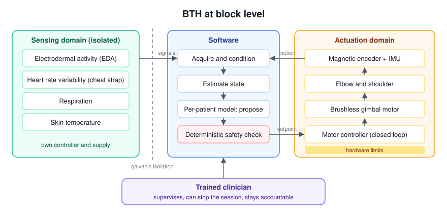
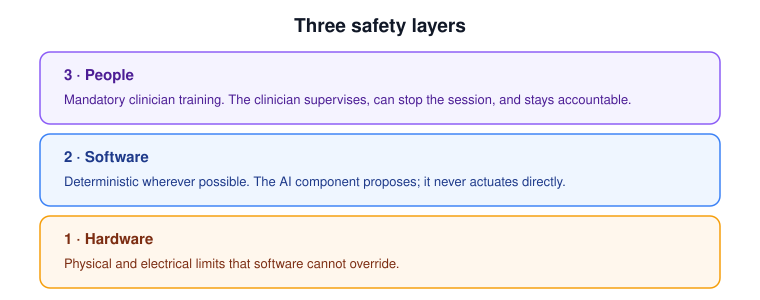
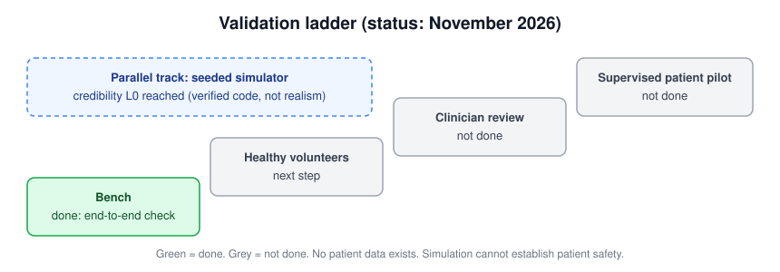

# BTH: a per-patient adaptive exosuit for post-stroke arm rehabilitation

> **BTH is a research prototype, not a medical device.**

**Research prototype. Not a medical device. No patient data has been collected.**

## In 30 seconds

Many stroke survivors never fully recover the use of their arm, and about a third develop depression after
the stroke. BTH is an upper-limb exosuit for the elbow and shoulder with built-in autonomic sensing (skin conductance, heart rate variability,
respiration, skin temperature). The goal is a system that learns each patient's own physiological
baselines and adapts the assistance to that patient, with a clinician in charge. The hardware exists and
runs end to end on the bench. Recorded sessions have not started yet.

## The problem

- **The arm often does not come back.** In patients whose arm is flaccid in the first days after stroke,
  only about 12% reach complete functional recovery at six months (Kwakkel et al., *Stroke*, 2003).
- **Mood is part of recovery.** Pooled across 61 studies, about 31% of stroke
  survivors develop depression (Hackett and Pickles, *Int J Stroke*, 2014).

Details and sources: [docs/01_problem.md](docs/01_problem.md).

## The insight

Patients differ. The same exercise can be easy for one person and overwhelming for another, and that
difference may be visible in autonomic signals. That is a hypothesis BTH is built to test. BTH treats
**per-patient personalization** as the core goal: one system, hardware and software designed together, that
learns *this* patient's autonomic baselines and adapts assistance to *this* patient, instead of applying one
threshold to everyone.

This is a thesis, not a result. Precedents exist in other fields: wearables tuned online to the individual
(Zhang et al., *Science*, 2017) and closed-loop systems that adapt to the patient inside hard safety limits
(Brown et al., *NEJM*, 2019). Neither shows that this works for stroke rehabilitation. Showing that is the work.

## System at a glance

- **Mechanics:** elbow and shoulder exosuit, brushless (gimbal) motors under closed-loop control, magnetic joint
  encoder, IMU. Variable-impedance assistance driven by physiological state.
- **Autonomic sensing:** electrodermal activity (EDA), heart rate variability (chest strap), respiration,
  skin temperature.
- **Cost:** prototype bill of materials about 200 EUR all-in.

The hard part is not the motor. It is getting trustworthy skin-conductance and heart-rate signals from a device
that has a motor in it. See [docs/02_hardware_and_research_problem.md](docs/02_hardware_and_research_problem.md).

## Safety philosophy

1. **Hardware limits** that software cannot override.
2. **Deterministic software where possible.** The AI component proposes; it never actuates directly.
3. **Mandatory clinician training.** Accountability stays with the clinician.

A separate governance layer around the adaptive component exists. It has its own showcase:
[bth-governance-showcase](https://github.com/yasferaru/bth-governance-showcase).

## Stack

- **Hardware:** elbow and shoulder exosuit, brushless gimbal motors with closed-loop drivers, magnetic joint encoder, IMU,
  EDA, chest-strap HRV, respiration and skin-temperature sensing on an isolated front-end.
- **Backend:** Python, FastAPI, SQLAlchemy with Alembic migrations, pydantic, NumPy, SciPy, pandas, scikit-learn.
- **Clinician dashboard:** React, Vite, Electron (desktop app, runs locally).
- **Governance layer:** Python standard library and pydantic, tested with pytest and Hypothesis, type-checked with mypy.
- **Simulator:** Python, seeded and reproducible.
- **Not built:** firmware for the hardware limits (specified only), any cloud or network deployment.

## What exists today

| Item | Status |
|---|---|
| Exosuit hardware with all sensors | Built. Tested end to end on the bench. |
| Recorded sessions (healthy volunteers) | Not yet. Motor problems have blocked them so far. |
| Patient data | None. |
| Software pipeline (acquire, condition, estimate state, adapt, safety) | Built and tested on a seeded simulator only. |
| Simulator calibrated with open datasets | Yes. Pre-registered studies with hashed pre-registrations. |
| Simulator credibility | Level L0: the code is verified against its own specification and is reproducible. It has **not** yet been shown to match real human data. |

Software overview: [docs/03_software_overview.md](docs/03_software_overview.md).
Testing and validation: [docs/04_evidence_and_validation.md](docs/04_evidence_and_validation.md).

## What is next

1. Recorded hardware sessions on healthy volunteers.
2. Informal review of the system and protocol by clinicians.
3. A lab to host the work.
4. A supervised pilot.

Roadmap: [docs/05_roadmap.md](docs/05_roadmap.md).

## What I am looking for

1. **A clinical pilot partner.** A clinic or a group of clinicians (neurorehabilitation, physiatry,
   occupational therapy) willing to review the system informally, then run a supervised pilot.
2. **A lab to host the work.** Neuro-rehabilitation, wearable robotics or psychophysiology.

## Vision

*This section is a vision, not a status.* A modular, per-patient adaptive "physical AI" platform for
rehabilitation: hardware and software that learn the individual patient. It starts with the arm.

## Team

Solo founder. Yasmyna Feraru, student of medicine and computer engineering in Italy.

## Contact

yasmyna.feraru(at)officialtetelestai.com · GitHub [@yasferaru](https://github.com/yasferaru)

## Scope of this repository

This repository describes the project. It contains no source code, firmware, schematics or data. Some
design details are deliberately not published.
