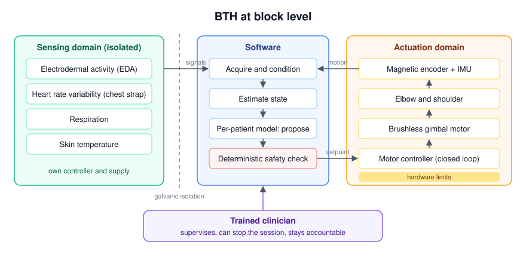
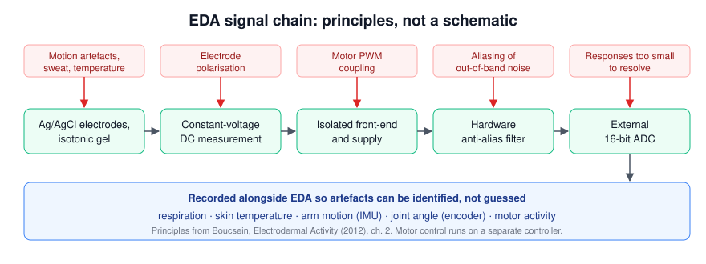

# 2. Hardware and the research problem

> **BTH is a research prototype, not a medical device.**

## 2.1 The hardware

BTH is an upper-limb exosuit for the elbow and shoulder. At block level it has two parts that are designed together:

- **Actuation:** brushless (gimbal) motors drive the elbow and shoulder under closed-loop control. A magnetic encoder
  measures the joint angle and an IMU measures arm motion. Assistance is variable-impedance: how stiff or
  compliant the support feels can change during a session.
- **Autonomic sensing:** electrodermal activity (EDA), heart rate variability (HRV, from a chest strap),
  respiration and skin temperature.

The prototype bill of materials is about 200 EUR all-in.

What is not published here: wiring, schematics, pinouts, component values, firmware, control gains,
the assistance range, and how physiological state is mapped to assistance.

## 2.2 The research problem: trustworthy EDA and HRV from a motor-driven wearable

Physiological sensing is usually done with the person sitting still, far from any motor. BTH needs it on a
moving arm, centimetres from a switching motor driver. Each of the problems below can produce a signal that
looks like a physiological response but is not. If the system cannot tell the difference, adaptation built
on top of it is worthless.

| Problem | Why it matters | Design principle (literature or standard practice) |
|---|---|---|
| **Motor PWM coupling into EDA** | The motor driver switches at high frequency. Coupled noise can appear in the EDA signal, whose responses are very small. | Galvanic isolation of the biosignal front-end from motor, battery and controller grounds, with an isolated supply. Motor control and sensing run on separate controllers. (Boucsein 2012, ch. 2, on isolating EDA from other circuits.) |
| **Motion artefacts** | Movement changes electrode-skin contact and local pressure, which produces artefacts that resemble skin-conductance responses. | Electrode site chosen to limit movement at the site; cables fixed and kept short; movement recorded (IMU, encoder) so that artefacts can be identified rather than guessed. (Boucsein 2012.) |
| **Skin temperature and sweat** | Skin conductance changes with temperature and with thermal (not emotional) sweating, which effortful exercise produces. | Skin temperature recorded as a covariate; a stabilisation period after electrode placement; isotonic electrolyte, not hypertonic ECG gel. (Boucsein 2012.) |
| **Electrode polarisation over long sessions** | DC measurement can polarise electrodes over time, producing slow drift that mimics a change in tonic level. | Non-polarisable Ag/AgCl electrodes; constant-voltage DC measurement, which the literature prefers for this reason; fresh electrodes and gel per session. (Boucsein 2012.) |
| **ADC resolution for small responses** | Skin-conductance responses used in research can be as small as 0.01 to 0.05 µS, on top of a much larger tonic level. A coarse converter cannot resolve them. | External 16-bit ADC, the resolution the literature names for resolving small responses. (Boucsein 2012, ch. 2.) |
| **Aliasing** | Motor and mains noise above the sampling band can fold into the signal band after sampling. | Hardware anti-alias low-pass filtering before the ADC; further filtering in software. Not filtering so hard that response shape is distorted. (Boucsein 2012.) |
| **Respiration-evoked EDA responses** | A deep breath can trigger a genuine skin-conductance response that is unrelated to the task. | Respiration recorded alongside EDA so such responses can be identified. (Boucsein 2012.) |
| **HRV artefacts** | Missed or extra beats distort HRV measures, especially in short windows. | Beat series checked, not only filtered automatically; short-window measures with good statistical properties; activity documented. (Task Force ESC/NASPE 1996.) |

Measurement method: constant-voltage DC (exosomatic) EDA, described in the literature as the standard for
recording both the tonic level and the fast responses (Boucsein 2012).

## 2.3 What has been measured, and what has not

| Question | Status |
|---|---|
| Do all sensors and the motor run together, end to end? | **Done** on the bench (functional check). |
| Is motor noise visible in EDA with the motor running, and how much? | **Not yet measured.** Needs recorded sessions. |
| How often do motion artefacts occur during assisted movement, and can they be detected? | **Not yet measured.** |
| How much do skin temperature and thermal sweating move EDA during a session? | **Not yet measured.** |
| Does electrode drift stay acceptable across a full session? | **Not yet measured.** |
| Is HRV from the chest strap usable during assisted arm movement? | **Not yet measured.** |
| Are a person's baselines stable from one session to the next? | **Not yet measured.** Needs repeated sessions. |
| Any measurement on a patient | **None.** No patient data exists. |

Motor problems have so far prevented recorded sessions. Recorded sessions on healthy volunteers are the next
step. No numbers will be published until they come from recorded data.

## 2.4 Open research questions

1. How clean can EDA be made in a motor-driven wearable, compared with a stationary laboratory recording?
2. Which artefacts can be detected reliably from the motion and motor signals the system already records?
3. How many sessions does it take to estimate one person's autonomic baselines well enough to use them?
4. Do autonomic responses to therapy effort in stroke survivors resemble those of healthy volunteers?
5. Which physiological signals, if any, carry information that movement data alone does not?

## Sources

- Boucsein W. *Electrodermal Activity*. 2nd ed. Springer; 2012. Chapter 2 (recording methods).
- Task Force of the European Society of Cardiology and the North American Society of Pacing and
  Electrophysiology. Heart rate variability: standards of measurement, physiological interpretation, and
  clinical use. *Circulation*. 1996;93(5):1043-1065.
