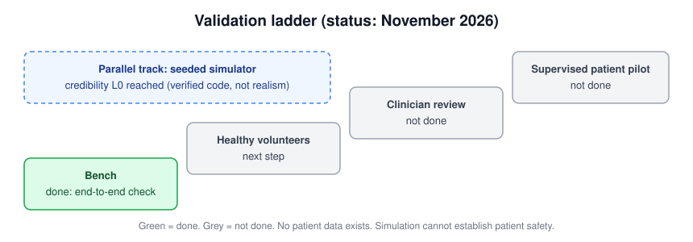

# 4. Evidence and validation

> **BTH is a research prototype, not a medical device.**

## 4.1 What has been tested, and on what

Everything on the software side has been tested on a **seeded simulator**, not on people. Simulated data
counts as simulated, and no claim about patients follows from it.

- **Seeded simulator.** Every run is reproducible from its seed.
- **Calibrated with open datasets.** Simulator parameters are fitted to, and checked against, public
  datasets (listed below). Calibration and validation use separate subjects.
- **Pre-registration.** Each simulator study is written down before it is run, and the file is hashed
  (SHA-256) so later edits are detectable. Changing a pass/fail rule after seeing results requires a new,
  dated pre-registration; the old one is kept.

## 4.2 Credibility levels

Credibility is judged per claim, not as one score. The simulator currently stands at **L0**.

| Level | Meaning | Status |
|---|---|---|
| L0 | Code verified against its own specification; reproducible; every parameter has a recorded source | **Reached** |
| L1 | Simulated signals match public data from healthy people | Not reached |
| L2 | Simulated signals match public data from post-stroke patients | Not reached |
| L3 | Matches our own healthy-volunteer exosuit sessions | Not reached (no sessions yet) |
| L4 | Matches clinic patient data | Not reached (no patient data) |

**What L0 means in plain words:** the software does what its specification says, on inputs whose correct
answer is known. It does **not** mean the simulator is realistic. Patient safety can never be established by
simulation; it needs clinical evidence.

## 4.3 Validation ladder for the system

| Step | What it shows | Status |
|---|---|---|
| Bench | Hardware and software run end to end | **Done** (functional check, no recorded sessions) |
| Healthy volunteers | Signal quality during assisted movement; baseline stability | Not done. Next step |
| Clinician review | Clinicians review the system, protocol and safety design | Not done |
| Patients | Supervised pilot | Not done. Requires a clinical partner and ethics approval |

## 4.4 Public datasets used for calibration and validation

Named and cited only. No data from these datasets is published here. Most are openly licensed;
WESAD has a restricted licence and nothing derived from them is shown.

- **U-Limb.** Averta G, et al. U-Limb: a multi-modal, multi-center database on arm motion control in healthy
  and post-stroke conditions. *GigaScience*. 2021;10(6):giab043.
- **Upper-limb kinematic and EMG dataset.** Lucchetti F, Bailo G, Lencioni T. A detailed kinematic and EMG
  dataset for upper limb and hand movement analysis in post-stroke and healthy subjects during functional
  daily tasks. *Scientific Data*. 2025.
- **WESAD.** Schmidt P, Reiss A, Duerichen R, Marberger C, Van Laerhoven K. Introducing WESAD, a multimodal
  dataset for wearable stress and affect detection. *ICMI* 2018.
- **Zenodo record 3713449.** Schwarz A, Held JPO, Luft AR. Post-stroke upper limb kinematics of a set of daily
  living tasks. Zenodo; 2020. doi:10.5281/zenodo.3713449.
- **Lokomat dataset, Zenodo record 15054030.** Chiappini, Malerba, et al. Summary features only.
- **PhysioNet culm** (v1.0.0, doi:10.13026/C24T0M). Miranda JGV, et al. Complex upper-limb movements are
  generated by combining motor primitives that scale with the movement size. *Sci Rep*. 2018;8(1).

## 4.5 Not claimed

- No efficacy claim. No safety claim for patients.
- No claim that simulated results transfer to real people until levels L1 to L4 are reached.
